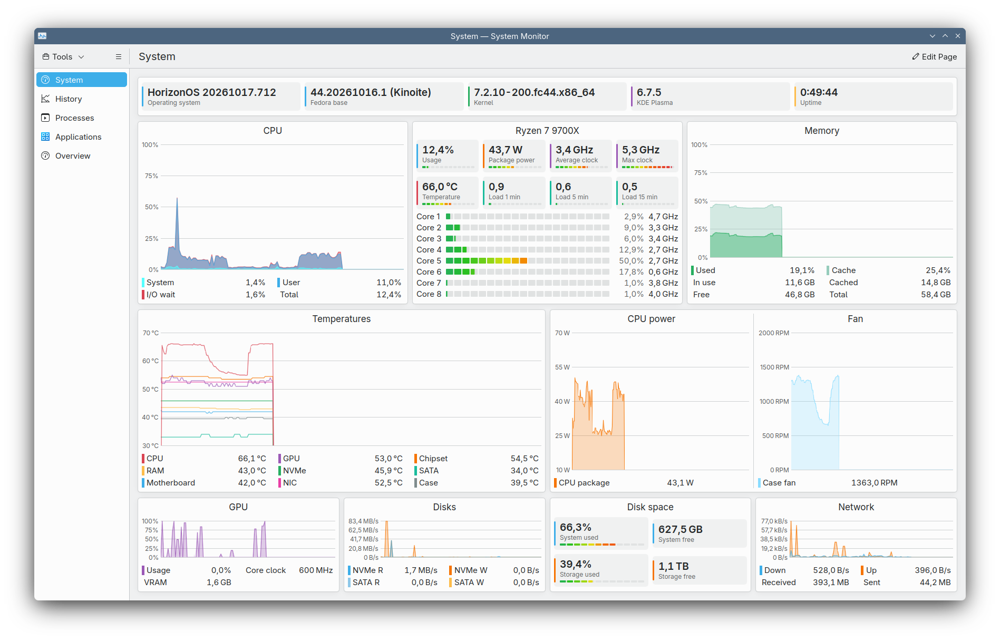

# plasma-systemmonitor

A hardware overview page for KDE System Monitor (`plasma-systemmonitor`, Plasma 6). It shows the state of the whole machine on one screen. A script builds the page from the sensors of the PC it runs on. The repo also includes a custom sensor face, **Graduated Bars**, for the tiles and per-core bars.



The page is installed as `System.page`, at the top of the page list. Every face updates once per second.

| Row | Height | Content |
| --- | --- | --- |
| 1 | `minimum` | Tiles: operating system, base version, kernel, Plasma, uptime |
| 2 | `balanced` | **CPU** (system / user / I/O wait stacked, total in the legend) · **CPU model** (summary tiles and per-core bars) · **Memory** (used + cache; in use, cached, free, total in the legend) |
| 3 | `balanced` | **Temperatures** · **CPU power** and **Fans** side by side |
| 4 | `minimum` | **GPU** (usage; clock and VRAM in the legend) · **Disks** (read/write) · **Disk space** · **Network** (download/upload; totals in the legend) |

The CPU face is titled with the CPU model (e.g. "Ryzen 7 9700X"):

- at the top, eight tiles: usage, package power, average clock, max clock, temperature, and load average over 1, 5 and 15 minutes, each with a small graduated bar;
- below, one row per physical core: the bar is the average usage of its threads, next to it the percentage and the clock.

*Disk space* has one tile per filesystem with the used percentage and a bar, and the free space next to it.

## Contents

| Path | What it is |
| --- | --- |
| `install.sh` | Installs the sensor face and the page for the current user |
| `generate-page.py` | Generates the page for the hardware of the PC it runs on (see below) |
| `sensorfaces/local.graduatedbars/` | The "Graduated Bars" sensor face, used for the system tiles, the CPU and the disk space |

## Installation

```bash
git clone https://github.com/itotm/plasma-systemmonitor.git
cd plasma-systemmonitor
./install.sh                     # generate the page for this PC and install it
./install.sh --start-page        # also make System Monitor open on the System page
./install.sh --page my.page      # install a page file of your own instead of generating one
```

The script:

1. runs `generate-page.py` and prints what it found (or uses the file given with `--page`);
2. closes System Monitor if it is running (otherwise it would write the old page back when it quits);
3. copies the face to `~/.local/share/ksysguard/sensorfaces/` and the page to `~/.local/share/plasma-systemmonitor/System.page`, keeping any previous page as `System.page.<date>.bak`;
4. puts `System.page` at the top of `pageOrder` in `~/.config/systemmonitorrc`, moving it if it was already in the list.

To look at the generated page without installing it: `./generate-page.py -o /tmp/test.page` (the summary goes to stderr). Use `--title` to change the page title.

## How the page is generated

`generate-page.py` reads the sensor list with `kstatsviewer --list` and samples their values for a couple of seconds. It then builds the page with the rules below. Anything it can't find is skipped and the row shrinks to fit.

| Part | How it is chosen |
| --- | --- |
| CPU title | `model name` from `/proc/cpuinfo` without the vendor, "(R)", "(TM)", "N-Core Processor" and the frequency |
| System tiles | The version tile is labelled "<distro> base" (from `NAME` in `/etc/os-release`) when `PRETTY_NAME` does not contain the distribution name, as on derivatives like HorizonOS |
| Cores | Threads grouped by physical core (`/sys/devices/system/cpu/cpuN/topology/core_id`). Above 16 cores, grouped by L3 cache (CCD/CCX) if there is more than one |
| CPU tiles | Bar ranges: clocks 0 – max frequency (`cpuinfo_max_freq`, rounded up to 100 MHz), load average 0 – number of threads, temperature 30–95 °C, power 0 – (chart scale + 20 W) |
| Temperatures | CPU (`cpu/all/averageTemperature`), GPU and lm-sensors in this order: CPU, GPU, first motherboard sensor, RAM (`spd5118`, `jc42`), NVMe (*Composite* only), SATA (`drivetemp`), second motherboard sensor, network card, third motherboard sensor, then the rest. Skipped: WiFi, CPU and GPU chips already covered, the motherboard's "CPU" sensor and values outside 0–115 °C (disconnected inputs). One colour per kind; scale 30–70 °C |
| Fans | lm-sensors `fanN` sensors that are spinning (> 0 RPM) when the page is generated. Scale up to 2000 RPM, or higher if a fan is already close to that |
| CPU power | A sensor from a ksystemstats script (`scripts/<script>/<sensor>` with `rapl`, `package` or `cpu` in the name); ksystemstats has none of its own. Chart scale from 10 W to 9 W per core (at least 70) |
| GPU | Every `gpu/gpuN`: usage in the chart; core clock and VRAM in the legend |
| Disks | `nvme*`, `sd*`, `vd*`, `mmcblk*` devices (at most 4); labelled "NVMe" or "SATA" when there is only one of that kind |
| Disk space | The filesystem of `/` (or of `/sysroot` on ostree systems such as Fedora Atomic) as "System", then the largest ones, named after their filesystem label; those under 8 GB are skipped, at most 3 |
| Network | The interface of the default route (`ip route show default`) |

Limitations:

- The page is a snapshot of the hardware at install time. If it changes, for example a new disk, a fan plugged in or an `nct6775` module loaded later, run `./install.sh` again.
- Fans that are stopped when the page is generated (zero RPM mode) are not included.
- Motherboard sensor labels come from lm-sensors (you can set them in `/etc/sensors.d/`). If the chip doesn't provide them, the sensor name is shown; you can rename them in *Edit Page*.
- The power scale is estimated from the number of cores: for CPUs with a very different TDP, adjust it in *Edit Page*.

## The "Graduated Bars" sensor face (`local.graduatedbars`)

Segmented bars with a green-to-red colour scale, plus tiles with a large value and a label. Change its options in *Edit Page* → edit the face, or in the page file under `[Face-N][local.graduatedbars][General]`. You can also use it on your own pages and in Plasma System Monitor widgets.

| Option | Default | Effect |
| --- | --- | --- |
| `segments` | 20 | Number of segments (fewer when the bar is narrow) |
| `useGradient` | true | Green-to-red colour; otherwise the sensor colour |
| `groupByLabel` | true | High priority sensors sharing a label are merged into a single row (average) |
| `showPeak` | true | For merged rows, also show the maximum (marker on the bar and a ▲ column) |
| `showLabels` | true | Show the labels on the left |
| `lowPriorityAsText` | false | A low priority sensor with the same label as a bar becomes its text (e.g. bar = usage, text = clock). Low priority sensors without a matching bar stay as text-only rows below a separator |
| `showBarValue` | false | With `lowPriorityAsText`, also show the bar's own value before the text (e.g. `12.3%  4.9 GHz`) |
| `extraAsTiles` | false | Low priority sensors without a matching bar become tiles above the bars: large value, label, a strip in the sensor colour and a small graduated bar if the sensor has a range |
| `tileColumns` | 4 | Tiles per row |
| `ranges` | empty | Per-sensor ranges for bars and tiles: `cpu/all/averageTemperature=30:95; cpu/loadaverages/loadaverage1=0:16`. Frequencies are in MHz. Without a range a tile has no bar, unless the sensor declares one (e.g. percentages); `0:0` removes it anyway |
| `rangeAuto`, `rangeFrom`, `rangeTo` | true, 0, 100 | Scale of the bars without `ranges`: automatic from the sensor if it declares one, otherwise these values |

Other behaviour:

- Frequencies (MHz) are always shown in GHz, so they don't jump between "605.0 MHz" and "3.3 GHz". Averaged values also show zero ("0.0%").
- A face with tiles only (no high priority sensors) centres them vertically.
- The face declares a minimum height equal to its content: if the window is short, System Monitor makes the row taller and the page scrolls instead of overlapping the text.
- The green → red scale interpolates the hue along the shorter arc, so orange → red doesn't go round the colour wheel through green and blue.

## Requirements

- Plasma 6 with `plasma-systemmonitor` and `ksystemstats` (tested with 6.7.5); `kreadconfig6`/`kwriteconfig6`; `python3` and `kstatsviewer` for the generator (all included in Fedora Kinoite).
- `lm-sensors` for motherboard temperatures and fans. Nuvoton chips sometimes need the `nct6775` module (or `nct6683` for NCT6686/6687) loaded at boot, for example: `echo nct6775 | sudo tee /etc/modules-load.d/nct6775.conf`. DDR5 temperatures come from the `spd5118` module, which loads automatically.
- CPU power needs a ksystemstats script (the `ksystemstats-scripts` package, scripts in `~/.local/share/ksystemstats-scripts/`), for example one reading RAPL from `/sys/class/powercap/intel-rapl:0/energy_uj`.

## Editing the page

- From *Edit Page* in System Monitor. To keep your changes when reinstalling, copy `~/.local/share/plasma-systemmonitor/System.page` somewhere and install it with `./install.sh --page <file>`.
- By hand, with System Monitor closed: otherwise it overwrites the file when it quits.
- Note: if you delete rows from *Edit Page*, System Monitor can leave stale `[page][row-N]` groups in the file, so rows get duplicated or disappear after a restart. To change the row structure, edit the file by hand.
- Sensor IDs are listed by `kstatsviewer --list`, in the sensor list of a face in *Edit Page*, or by `sensors` for the `lmsensors/<chip>/<sensor>` ones.

## License

[GPL-3.0-or-later](LICENSE).
